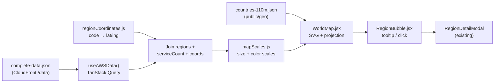

# Region Map — Feature Plan

**Status:** Planning (not started)
**Created:** October 23, 2026

A world map that plots every AWS region as a circle. Bigger circles mean more services, and the color deepens with the count so the map reads like a heat map. It uses the data the site already loads.

---

## Contents

- [Data Inventory](#data-inventory)
- [Architecture](#architecture)
- [Rendering Approach](#rendering-approach)
- [Visual Encoding](#visual-encoding)
- [Overlapping Regions](#overlapping-regions)
- [Interaction & Integration](#interaction--integration)
- [Placement](#placement)
- [Proposed File Layout](#proposed-file-layout)
- [Implementation Phases](#implementation-phases)
- [Open Decisions](#open-decisions)
- [Appendix: Current Regions](#appendix-current-regions)

---

## Data Inventory

The data comes from `/data/complete-data.json`, which `useAWSData()` already fetches and caches with TanStack Query.

| Need | Source | Available? |
|------|--------|------------|
| Region list (code, name) | `regions.regions[]` | Yes, 39 regions |
| Availability zones | `regions.regions[].availabilityZones` | Yes |
| Launch date / blog link | `regions.regions[].launchDate`, `blogUrl` | Yes |
| Service count per region | `servicesByRegion.byRegion[code].serviceCount` | Yes, range 143–394 of 406 |
| **Latitude / longitude** | — | **No, this is the gap** |

### Getting coordinates

1. **Static lookup in this repo (start here):** `src/config/regionCoordinates.js`, mapping each region code to `{ lat, lng, city }` (39 entries). This unblocks the feature right away.
2. **Fetcher data contract (long term):** add `latitude`/`longitude` to the region objects in [aws-infrastructure-fetcher](https://github.com/jxman/aws-infrastructure-fetcher). This is the cleaner home, but it needs a second repo and a data contract update.

**Unknown regions:** the data refreshes daily, so a newly launched region will show up before it has coordinates. Skip it on the map, list it below the map as "not yet mapped", and log a `console.warn` in development.

---

## Architecture



---

## Rendering Approach

| Option | Pros | Cons |
|--------|------|------|
| **`d3-geo` + `topojson-client` + `world-atlas` (110m)** (recommended) | Small (~100 KB topojson plus a little d3), full SVG control, dark mode is easy with Tailwind classes | You write the SVG yourself |
| `react-simple-maps` | Quick declarative API | Lightly maintained, and its peer dependencies lag React versions |
| Leaflet / Mapbox | Real pan, zoom and tiles | Heavy, needs a tile provider and maybe API keys, overkill for 39 dots |
| Static image + positioned dots | No dependencies | Fragile projection math, poor responsiveness and theming |

- **Projection:** Natural Earth (`geoNaturalEarth1`) or Equal Earth (`geoEqualEarth`). Both suit a world overview better than Mercator.
- **Geography data:** bundle the topojson in `public/geo/` (served by the same CloudFront distribution) instead of loading it from a CDN at runtime.
- `recharts` is already a dependency but has no geographic support, so it doesn't help here.

---

## Visual Encoding

- **Size:** scale the circle's **area**, not its radius, with the service count:
  `d3.scaleSqrt().domain([minCount, maxCount]).range([6, 22])`.
  A linear radius would exaggerate the differences.
- **Heat color:** add a sequential color scale on the same value (light to deep, using the Tailwind palette and tuned for both light and dark mode), so the map still reads as a heat map where circles overlap.
- **Fill / stroke:** semi-transparent fill (~0.6 opacity) with a solid stroke, so overlapping circles stay distinguishable.
- **Legend:** three reference circles (~150 / 250 / 400 services) plus a color ramp.
- **Optional toggle:** "Size by: Services | Availability Zones". The data already exists.
- **Optional partition styling:** a dashed stroke for the separate partitions (GovCloud `us-gov-*`, China `cn-*`, Sovereign Cloud `eusc-*`), since they aren't part of the standard commercial footprint.

---

## Overlapping Regions

This is the hard part. Several regions sit close together:

| Area | Regions |
|------|---------|
| US East | `us-east-1` (N. Virginia), `us-east-2` (Ohio), `us-gov-east-1` |
| US West | `us-west-1` (N. California), `us-west-2` (Oregon), `us-gov-west-1` |
| Europe | Frankfurt, Zurich, Paris, London, Ireland, Milan, Stockholm, Spain, Sovereign Cloud (Germany) |
| East Asia | Tokyo / Osaka, Hong Kong / Taipei, Beijing / Ningxia |
| Southeast Asia | Singapore, Jakarta, Malaysia, Thailand |
| Oceania | Sydney / Melbourne |

Mitigations, in order of effort:

1. **Draw order:** largest circles first, smallest last, so small ones stay visible and clickable.
2. **Hover / focus tooltip:** shows name, code, service count, AZs and coverage %. The hovered or focused circle comes to the front.
3. **Collision nudge:** run `d3-force` `forceCollide` once (not animated) and draw a thin leader line back to the true location.
4. **Zoom presets:** "World | N. America | Europe | APAC". Each preset changes the projection's center and scale, which is cheaper than full pan and zoom.

---

## Interaction & Integration

- **Click:** opens the existing `RegionDetailModal` (`src/components/common/RegionDetailModal.jsx`), which reuses existing code and matches the Regions page.
- **Search:** reuse `parseSearchTerms()` and `matchesAnyTerm()` from `src/utils/searchUtils.js` to highlight matching regions and dim the rest (comma-separated multi-term, same as the other pages).
- **Analytics:** a GA4 event on circle click, following the detail-view event pattern from commit `214c6c1`.
- **Accessibility:**
  - Each circle gets `role="button"`, `tabIndex={0}`, and an `aria-label` such as "US East (N. Virginia), 394 services".
  - Enter / Space opens the modal.
  - A collapsible or visually hidden data table with the same data, since a map alone isn't screen-reader friendly.
- **Dark mode:** country fills, borders and circle colors come from Tailwind classes or `ThemeContext`.
- **Responsive:** the SVG uses a `viewBox` and scales to its container. On mobile, consider defaulting to a regional preset or showing the list view.

---

## Placement

- **Option A (recommended):** a new `/map` route (`src/views/RegionMap.jsx`) with a header nav link. Lazy-load it with `React.lazy` so the map libraries and topojson don't affect the size of the other pages' bundles.
- **Option B:** a compact, non-interactive mini-map card on the Dashboard that links to `/map`.

Start with A and add B later.

Follow-ups for a new route: add it to `scripts/deploy.sh` Step 6 route verification, the sitemap/SEO setup, and `CanonicalTag`.

---

## Proposed File Layout

```
src/config/regionCoordinates.js      # code → { lat, lng, city }
src/utils/mapScales.js               # size and color scale builders (pure, testable)
src/components/map/WorldMap.jsx      # SVG, projection, country paths
src/components/map/RegionBubble.jsx  # one circle with tooltip and click handler
src/components/map/MapLegend.jsx     # size and color legend
src/views/RegionMap.jsx              # page: data hook, search, zoom presets
public/geo/countries-110m.json       # bundled world-atlas topojson
```

New dependencies: `d3-geo`, `d3-scale`, `topojson-client` (plus `d3-force` in Phase 2 if the collision nudge is used). Copy `world-atlas` into `public/geo/` as a static asset rather than adding it as a runtime dependency.

---

## Implementation Phases

### Phase 1 — MVP
- [ ] Coordinates table for all 39 regions
- [ ] Static world map (Natural Earth projection, 110m countries)
- [ ] Square-root-scaled circles plus color scale
- [ ] Hover tooltip
- [ ] Legend
- [ ] Dark mode
- [ ] `/map` route, lazy-loaded, with a nav link

### Phase 2 — Usability
- [ ] Click opens `RegionDetailModal`
- [ ] Zoom presets (World / N. America / Europe / APAC)
- [ ] Collision nudge with leader lines
- [ ] Search highlight using `searchUtils`
- [ ] "Not yet mapped" list for regions without coordinates

### Phase 3 — Polish
- [ ] Services / AZs size toggle
- [ ] Partition styling (GovCloud, China, Sovereign Cloud)
- [ ] Accessible data table
- [ ] Dashboard mini-map card
- [ ] GA4 click event
- [ ] Deploy script route check, sitemap, docs updates (README, DEV_INSTRUCTIONS, DESIGN_PLAN)

### Phase 4 — Later
- [ ] Move coordinates into the fetcher's data contract and drop the local lookup

---

## Open Decisions

- [ ] **Placement:** a new `/map` page, a Dashboard card, or both?
- [ ] **Overlap handling:** hover tooltips only, or the collision nudge too?
- [ ] **Coordinates:** in this repo for now, or straight into the fetcher?
- [ ] **Partitions:** show GovCloud, China and Sovereign Cloud regions on the map, style them differently, or hide them behind a toggle?

---

## Appendix: Current Regions

Snapshot from `complete-data.json` (data timestamp `2026-10-23T02:00:33Z`), sorted by service count. Total services: 406.

| Code | Name | Services | AZs |
|------|------|---------:|----:|
| `us-east-1` | US East (N. Virginia) | 394 | 6 |
| `us-west-2` | US West (Oregon) | 362 | 4 |
| `eu-west-1` | Europe (Ireland) | 346 | 3 |
| `ap-southeast-2` | Asia Pacific (Sydney) | 339 | 3 |
| `eu-central-1` | Europe (Frankfurt) | 339 | 3 |
| `ap-northeast-1` | Asia Pacific (Tokyo) | 335 | 4 |
| `ap-southeast-1` | Asia Pacific (Singapore) | 323 | 3 |
| `eu-west-2` | Europe (London) | 318 | 4 |
| `us-east-2` | US East (Ohio) | 309 | 3 |
| `ap-northeast-2` | Asia Pacific (Seoul) | 303 | 4 |
| `ca-central-1` | Canada (Central) | 302 | 3 |
| `ap-south-1` | Asia Pacific (Mumbai) | 299 | 3 |
| `eu-north-1` | Europe (Stockholm) | 269 | 3 |
| `sa-east-1` | South America (Sao Paulo) | 263 | 3 |
| `eu-west-3` | Europe (Paris) | 262 | 3 |
| `us-west-1` | US West (N. California) | 256 | 3 |
| `af-south-1` | Africa (Cape Town) | 226 | 3 |
| `us-gov-west-1` | AWS GovCloud (US-West) | 226 | 3 |
| `ap-east-1` | Asia Pacific (Hong Kong) | 224 | 3 |
| `eu-south-1` | Europe (Milan) | 221 | 3 |
| `ap-northeast-3` | Asia Pacific (Osaka) | 220 | 3 |
| `eu-south-2` | Europe (Spain) | 209 | 3 |
| `me-south-1` | Middle East (Bahrain) | 207 | 3 |
| `us-gov-east-1` | AWS GovCloud (US-East) | 202 | 3 |
| `il-central-1` | Israel (Tel Aviv) | 194 | 3 |
| `eu-central-2` | Europe (Zurich) | 192 | 3 |
| `ap-south-2` | Asia Pacific (Hyderabad) | 190 | 3 |
| `me-central-1` | Middle East (UAE) | 190 | 3 |
| `ap-southeast-3` | Asia Pacific (Jakarta) | 189 | 3 |
| `ap-southeast-5` | Asia Pacific (Malaysia) | 188 | 3 |
| `ap-southeast-4` | Asia Pacific (Melbourne) | 181 | 3 |
| `cn-north-1` | China (Beijing) | 167 | 3 |
| `cn-northwest-1` | China (Ningxia) | 167 | 3 |
| `ca-west-1` | Canada West (Calgary) | 165 | 3 |
| `ap-southeast-7` | Asia Pacific (Thailand) | 160 | 3 |
| `mx-central-1` | Mexico (Central) | 154 | 3 |
| `eusc-de-east-1` | AWS European Sovereign Cloud (Germany) | 145 | 3 |
| `ap-southeast-6` | Asia Pacific (New Zealand) | 144 | 3 |
| `ap-east-2` | Asia Pacific (Taipei) | 143 | 3 |
